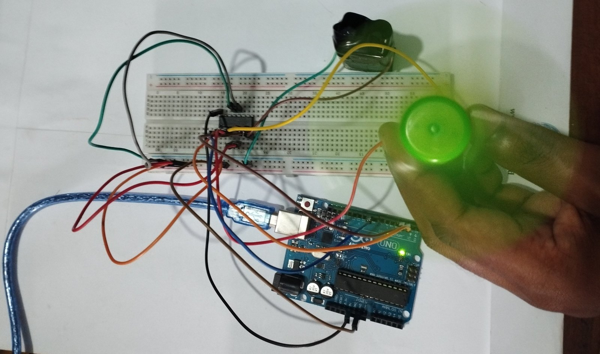

# DC Motor Speed and Direction Control using Arduino and L293D

An Arduino Uno project that controls the speed and the direction of a DC motor through an L293D motor driver IC. A potentiometer sets the speed with PWM, and two push buttons select forward or reverse rotation. The current direction and the PWM value are printed on the Serial Monitor.

Lab experiment (Experiment 07), Department of Electrical and Electronic Engineering, Rajshahi University of Engineering & Technology (RUET).



## How it works

- The potentiometer is read on `A0` (0 to 1023) and mapped to a PWM value from 0 to 255. This value is written to the L293D enable pin with `analogWrite`, so the average motor voltage, and therefore the speed, follows the potentiometer.
- The two buttons use the Arduino internal pull-up resistors, so a pressed button reads LOW.
- The direction is set by the logic levels on the two L293D inputs `IN1` and `IN2`:

| Forward button (D4) | Reverse button (D5) | IN1 | IN2 | Enable (PWM) | Motor |
| --- | --- | --- | --- | --- | --- |
| pressed | any | HIGH | LOW | speed from potentiometer | Forward |
| not pressed | pressed | LOW | HIGH | speed from potentiometer | Reverse |
| not pressed | not pressed | LOW | LOW | 0 | Stopped |

If both buttons are pressed, forward takes priority.

- The loop repeats every 100 ms and prints one of these lines at 9600 baud:
  - `Forward | Speed (PWM): 128`
  - `Reverse | Speed (PWM): 128`
  - `Motor Stopped`

## Circuit


The diagram was drawn from the sketch and the L293D datasheet pin numbers. The motor is connected between `OUT1` (pin 3) and `OUT2` (pin 6). The motor is powered from a separate 9 V supply at `VS` (pin 8), and the logic of the IC is powered from the Arduino 5 V at `VSS` (pin 16). The grounds of the Arduino, the battery and the IC must be connected together.

## Hardware

| Part | Quantity | Notes |
| --- | --- | --- |
| Arduino Uno R3 | 1 | ATmega328P, 5 V, 16 MHz |
| L293D motor driver IC | 1 | Dual H-bridge, 600 mA per channel |
| DC motor | 1 | 5 V to 12 V, 200 to 300 RPM |
| Potentiometer | 1 | 10 kohm |
| Push buttons | 2 | Tactile |
| Breadboard and jumper wires | | |
| 9 V battery or DC supply | 1 | 500 mA, for the motor |
| USB cable | 1 | Programming and Serial Monitor |

## Pin map

| Function | Arduino pin | L293D pin |
| --- | --- | --- |
| Speed (PWM, enable A) | D9 | 1 (EN1) |
| Direction input 1 | D8 | 2 (IN1) |
| Direction input 2 | D7 | 7 (IN2) |
| Forward button | D4 | |
| Reverse button | D5 | |
| Potentiometer wiper | A0 | |

## Build and run

1. Open `dc-motor-control-using-arduino.ino` in the Arduino IDE and select the **Arduino Uno** board. No external library is needed.
2. Wire the circuit according to the diagram above. Check that the grounds are common and that the motor supply is connected to pin 8 of the L293D.
3. Upload the sketch and open the Serial Monitor at 9600 baud.
4. The motor is stopped at start. Press the forward button and turn the potentiometer to change the speed, then release it and press the reverse button to reverse the rotation.

## Experiment results

As recorded in the lab report (`dc-motor-control-report.pdf`):

- The forward button gave `IN1 = HIGH`, `IN2 = LOW` and the motor turned clockwise. The reverse button swapped the inputs and reversed the rotation.
- The PWM value was about 0 at the minimum potentiometer position (the motor stopped), about 128 at the middle position (about 50 percent duty cycle, medium speed) and 255 at the maximum position (full speed).
- The L293D supplied the motor current that the Arduino pins cannot provide, and its internal diodes protected the circuit from the voltage spikes of the motor.

## Notes and limitations

- The L293D is rated for 600 mA per channel. A stalled or heavily loaded motor can draw more and overheat the IC.
- At very low PWM values the motor may not have enough torque to start turning.
- The sketch has no soft start or braking. Changing direction while the motor is running reverses the voltage suddenly.

## Repository contents

```
dc-motor-control-using-arduino/
  dc-motor-control-using-arduino.ino   Arduino sketch
  dc-motor-control-report.pdf          Experiment report
  circuit-diagram.png                  Connection diagram
  exp-set-up.jpg                       Photo of the experimental setup
  README.md
```

## Author

Md. Raiyan Mahmud, EEE, RUET. Portfolio: https://raiyan2064.github.io
